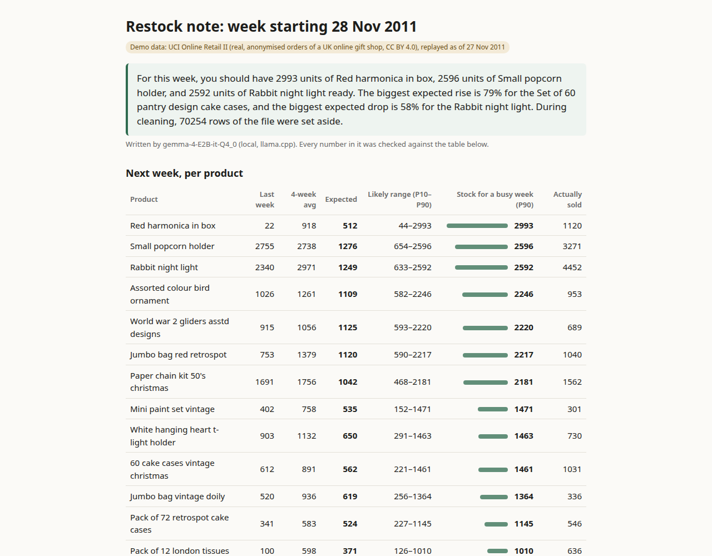

# tidy-predict

**A weekly restock note you can sell to small online shops, made on your own laptop.**

The shop sends its messy order export. tidy-predict cleans it, forecasts next week's units for the shop's regular
sellers with **TabPFN-2**, and has **Gemma**, a small open-weight model running locally, write a short note the
owner can act on. A checker rejects any number in the note that isn't in the forecast table. Nothing is sent to an
AI API: the shop's customer and order data stays on the machine that runs the tool.

**Built with PriorLabs-TabPFN.**



> **Demo data:** [UCI Online Retail II](https://archive.ics.uci.edu/dataset/502/online+retail+ii): real, anonymised
> transactions of a UK online gift shop, Dec 2009 – Dec 2011, CC BY 4.0 (Chen, D., 2012, DOI 10.24432/C5CG6D).
> It is not a client. The demo "replays" it: it pretends today is Sunday 27 Nov 2011, forecasts the week
> of 28 Nov, then shows what really sold that week.

## Demo video

[`demo/tidy-predict-demo.mp4`](demo/tidy-predict-demo.mp4) (83 s, voiceover; it ends with the honest numbers, including the rabbit night light miss). It shows one real run through the
local web page on the full demo file. How it was edited:
- the live log is sped up about 10× and labelled on screen (the run took 113 s, while the screen recorder and other
  jobs shared the CPU);
- the report is shown as still screenshots of that same run's report, re-rendered from its `run.json` after a
  layout-only fix (the busy-week number now sits next to its bar). The numbers and Gemma's note are the run's own;
- the narration was voiced locally with Kokoro.

QA (`demo/qa.json`): 1920×1080, −14.64 LUFS, true peak −1.38 dBTP, no silence longer than 0.6 s. Every frame
(one per 2 s) was checked at full size.

### Reading the replayed week (28 Nov 2011) honestly

- **Expected units are low.** Added up, the 20 medians said 13,386 units; the shop sold 19,101 (30% more). The 20
  products are picked *because* they sold a lot recently, and such products usually fall back a bit the next week,
  so a good model expects less than the recent average. The simple rule learned the same thing on the validation
  weeks: its tuned middle factor is k = 0.78. In the week of 28 Nov, at the start of the December rush, that
  pattern broke. Rabbit night lights, expected to drop 58%, sold 4,452 (its second-best week in the data).
- **Why the note starts with Red harmonica in box (2,993).** The note leads with the three highest "stock for a busy
  week" (P90) numbers, by design. A lumpy wholesale item like this one (22 sold last week, 918 a week on average
  over the last 4) gets a very wide range, so its P90 is high even though its expected number (512) isn't. The P90
  is a ceiling for a busy week, not a prediction. It sold 1,120.

## Who it's for

A freelancer (or a shop owner) who already helps small online shops with their spreadsheets. Each week the shop
exports its orders; tidy-predict turns that file into:

- `report.html`: the note, a table of next week's expected units per product with a likely range, and what was
  cleaned (screenshot above);
- `forecast.csv`: expected units, P10, P50 and P90 per product;
- `clean_sales.csv`: the rows that count as sales;
- `issues.csv`: every row that was set aside, with its row number and the reason. Nothing is deleted silently.

## What it does, step by step

1. **Reads the export** (`.csv` or `.xlsx`) and finds the columns. Header rules handle common names ("Qty",
   "Order date", "SKU"...). When they can't place a required column, the local Gemma model is asked. Its answer
   is limited by a JSON schema to the file's real headers, and it may only fill gaps.
2. **Cleans it** (`tidy_predict/clean.py`). It removes exact duplicates (in the demo file, 22,523 of the 34,335 come
   from its two Excel sheets overlapping on 1–9 Dec 2010: `sheet_overlap.json`); reads mixed date formats; sets aside
   postage, fee and manual-adjustment lines; sets aside returns. Each cancellation is matched to the sale it
   undoes (same customer, product and quantity, most recent earlier sale), and both lines are set aside.
3. **Builds weekly units** per product, keeping only full weeks, and picks the **regular sellers**: products
   sold in at least 20 of the last 26 weeks, top 20 by units.
4. **Forecasts next week with TabPFN-2** (`tidy_predict/forecast.py`): one model across all 20 products. The
   features are only from earlier weeks: lags of 1–4 and 52 weeks, 4/8/26-week averages, the share of zero weeks
   and the week of the year. It uses the CPU, at most 1,000 training rows, and 4 ensemble members. TabPFN gives a
   full predictive distribution, so each product gets a median and a P10–P90 range. The note's "stock for a busy
   week" number is the P90.
5. **Writes the note with Gemma** (`tidy_predict/note.py`). Gemma 4 E2B runs through llama.cpp on the same
   laptop and gets only a small facts table. `tidy_predict/numcheck.py` pulls every number out of the draft and
   rejects the draft if any number isn't in the facts. Gemma gets one retry, told which numbers were wrong. After
   that, a plain template is used. The report always says who wrote the note.

## How good is the forecast? (honest numbers)

All numbers below come from files in [`eval/results/`](eval/results), written by the scripts in [`eval/`](eval).

**Setup:** a rolling one-week-ahead test on the **last 12 full weeks** of the demo data (12 Sep – 28 Nov 2011).
For each week, the 20 regular sellers are chosen using only earlier weeks, giving 240 product-weeks. The model
setup was chosen **beforehand** on 7 separate validation weeks (Jul–Aug 2011, `model_selection.json`), and the
test was run once. On those weeks the two target framings tied: "level" 0.565 vs "relative" 0.563 mean weekly WAPE
(relative was also faster). The simpler level target was kept; the difference was within noise.

| Method (point forecast) | WAPE ↓ | Mean abs. error (units) |
|---|---|---|
| **TabPFN-2, median** | **0.502** | 355 |
| Mean of the last 4 weeks | 0.491 | 348 |
| Gradient boosting (scikit-learn, same features) | 0.527 | 373 |
| Last week's units | 0.631 | 446 |
| Same week last year | 0.884 | 626 |

WAPE = total absolute error ÷ total units sold (`backtest_summary.json`).

**What this shows** (more detail in `tie_analysis.json`, from `eval/tie_analysis.py`):
- For the single "expected units" number, **TabPFN-2 ties a plain 4-week average** (0.502 vs 0.491; median weekly
  WAPE 0.484 vs 0.485). It beats a gradient-boosting model trained on the same features, and both naive
  baselines. This shop's weekly demand is lumpy (wholesale customers), so nobody gets close to perfect.
- The tie hides a split:
  - TabPFN-2 had the lower WAPE in **7 of the 12 weeks**, and over the first 11 weeks it was ahead (0.502 vs 0.514).
  - The last week (28 Nov 2011, the start of the December rush) decided it: 0.505 vs 0.312.
  - That week TabPFN-2 expected rabbit night lights to *drop* 58% against their 4-week average; the shop sold 4,452,
    far above even the busy-week number (2,592). The 4-week average was riding the November ramp and got much
    closer.
  - On the 7 validation weeks (Jul–Aug 2011) TabPFN-2 was ahead too: mean weekly WAPE 0.565 vs 0.627.
- **A simple rule tuned on earlier weeks is a serious rival.** "4-week mean × k", with each k tuned on the
  validation weeks only and then applied unchanged to the test weeks:

  | On the 240 test product-weeks | TabPFN-2 | 4-week mean × k (k from validation) | Simple per-product band |
  |---|---|---|---|
  | Point forecast WAPE | 0.502 | **0.486** (k = 0.78) | – |
  | Pinball loss at P90 (the "busy week" number) ↓ | 139.9 | **122.8** (k = 2.09) | 171.6 |
  | Pinball loss at P10 ↓ | **52.3** | 58.8 (k = 0.20) | 56.7 |
  | 80% interval (Winkler) score ↓ | 1,923 | **1,816** | 2,283 |
  | P10–P90 coverage (target 80%) / width ÷ actual | **80.0%** / **1.50×** | 85.4% / 1.78× | 84.6% / 2.60× |
  | Stock to the top number: in stock / leftover / short units | **89.2%** / **160k** / 19.5k | 88.3% / 178k / **13.0k** | 91.7% / 326k / 9.5k |

- **What TabPFN-2 delivered:** a range for every product that came out calibrated (80.0% inside P10–P90, the
  target), 16% narrower than the tuned rule's (1.50× vs 1.78×), and 17k fewer leftover units when stocking to the
  top, at the cost of 6.5k more units short.
- **The honest tie:** on the middle number and the busy-week number, the scaled 4-week average did as well or
  slightly better (WAPE 0.486 vs 0.502; P90 pinball 122.8 vs 139.9).
- **The difference:** TabPFN-2 had **no per-shop factors fitted**. The simple rule needed a separate tuning period
  to pick its k values, and they may not carry over to the next shop. (TabPFN-2's own setup, i.e. the target
  framing, 4 estimators and 1,000 rows, was chosen once on the validation weeks.)
- The simple per-product band (`interval_baseline.json`) covered 84.6% but was 74% wider than TabPFN-2's range.
- This is one shop and 12 weeks. A freelancer should run `eval/backtest.py` and `eval/tie_analysis.py` on each
  client's own history and use whichever wins there.

**Speed and memory** on a 2019 laptop CPU (Intel i5-1035G1, 4 cores, no GPU, WSL2, shared with other work):
- reading and cleaning 1,067,371 rows takes about 23 s at 771 MB peak (`prepare.log`);
- a TabPFN-2 forecast for 20 products takes a median of **21.4 s**;
- the whole 12-week test took 5 min 11 s at 770 MB peak (`backtest.log`).

## How well does the Gemma part work?

Gemma 4 E2B (Q4_0 GGUF, 2.8 GB) through llama.cpp on the same CPU, with "thinking" switched off. Files in
`eval/results/`.

- **Notes:** one restock note for each of the 12 test weeks (`note_eval.json`). **12 of 12 passed the number
  check on the first draft**, so 0 drafts were rejected. The median was 35.8 s per note.
  - The first version of the prompt (`note_eval_v1.json`) also passed 12/12. Reading the notes by hand showed two
    problems the checker can't catch. Some notes echoed field names ("change vs 4wk avg pct of -53"). And "the
    biggest change" was judged only over the 8 items Gemma was shown. So the biggest rise and drop are now
    computed in code and handed to Gemma as facts.
  - The reject → retry → template path is covered by unit tests with a fake model.
- **Unusual column headers:** 12 header sets written for this test (synthetic, in `eval/header_variants.json`),
  e.g. "Bill No / Maal / Kitne / Tarikh / Rate" or "Txn / Listing / Copies / Paid on".
  - Header rules alone handle **3 of 12**.
  - With Gemma filling gaps, the first version handled **8 of 12** but made **4 wrong mappings** of optional
    columns, e.g. a batch number as the product code (`columns_eval_v1.json`).
  - Gemma was then limited to the *required* gaps only (date, quantity, which column names the product). That gives
    **12 of 12, 0 wrong**, median 7.4 s (`columns_eval.json`). These are the same cases that were looked at while
    fixing it, so treat 12/12 as optimistic.
- **A full run** on the 1,067,371-row demo file, with the note written by Gemma, took **52 s** from the command
  line: 16 s of that was the TabPFN-2 forecast, and the app peaked at 1.36 GB. The recorded web run in the video
  took 113 s, because the screen recorder and other jobs were sharing the CPU. llama-server showed about 2.6 GB
  RSS, most of it the memory-mapped model file.

## Run it

Needs Python 3.10+, about 3.5 GB of disk for the models, and about 3 GB of free RAM. No GPU, no API keys.

```bash
git clone https://github.com/xexpertai/tidy-predict && cd tidy-predict
python -m venv .venv && source .venv/bin/activate
pip install torch --index-url https://download.pytorch.org/whl/cpu   # CPU-only PyTorch (smaller)
pip install -e ".[dev]"
scripts/get-model.sh          # llama.cpp (CPU build) + Gemma 4 E2B GGUF (~2.8 GB) + TabPFN-2 weights (~30 MB)
scripts/start-model.sh &      # local model server on 127.0.0.1:8088

# web page (127.0.0.1 only)
tidy-predict serve            # open http://127.0.0.1:8765, pick the export, click "Make the restock note"

# or the command line
tidy-predict orders.csv --out out/
tidy-predict orders.csv --no-llm   # no model server needed; template note
```

To reproduce the demo and the numbers:

```bash
mkdir -p data/raw && curl -L -o data/raw/online_retail_ii.zip \
  https://archive.ics.uci.edu/static/public/502/online+retail+ii.zip && unzip -d data/raw data/raw/online_retail_ii.zip
python scripts/xlsx_to_csv.py data/raw/online_retail_II.xlsx data/raw/online_retail_II.csv
python eval/prepare.py data/raw/online_retail_II.csv eval/results   # clean + weekly table
python eval/select_model.py eval/results                            # validation weeks only
python eval/backtest.py eval/results 12                             # final test
python eval/interval_baseline.py eval/results
python eval/tie_analysis.py eval/results                            # week wins, tuned 4-week-mean rival, stocking
python eval/sheet_overlap.py data/raw/online_retail_II.xlsx eval/results   # where the duplicates come from
eval/offline_check.sh                                               # the forecast with no network at all
eval/run_with_model.sh                                              # Gemma: header mapping, notes, demo run
pytest                                                              # 28 tests, no model needed
```

**Offline:** once the weights are downloaded, the forecast works with networking switched off. This was checked
by running tidy-predict's own forecast on the full demo file inside a Linux network namespace with no network at
all (`unshare -rn`, script `eval/offline_check.sh`, log `eval/results/offline_check.log`). TabPFN has no telemetry. Its
only network code downloads weights or logs in for the newer non-commercial models, which this project never
loads.

## Limits (read before selling it)

- It forecasts **regular sellers only** (sold in at least 20 of the last 26 weeks). New or occasional products
  get no number.
- One week ahead only. Holidays and promotions are not modelled beyond "week of the year" and the 52-week lag.
- The "not a product" rule treats stock codes with no digits as postage or fees. In the demo data that also set
  aside 50 lines with codes `DCGSSGIRL`, `DCGSSBOY`, `DCGSLBOY` and `DCGSLGIRL` that look like real products. The list is in
  `eval/results/clean_stats.json`.
- On CPU, TabPFN-2 is limited to 1,000 training rows here, so long histories are cut to the most recent rows.
- The forecast quality above is for one shop's data. Run `eval/backtest.py` on a client's own history before
  promising anything.

## Licences and credits

- **This repository:** MIT (see `LICENSE`).
- **TabPFN-2 model weights** by Prior Labs ([classifier](https://huggingface.co/Prior-Labs/TabPFN-v2-clf),
  [regressor](https://huggingface.co/Prior-Labs/TabPFN-v2-reg)) are under the **Prior Labs License**: Apache 2.0
  with an extra attribution clause. It requires showing "Built with PriorLabs-TabPFN" (done here, on the web
  page and on every report) and passing on the licence with the weights. This repo doesn't redistribute the
  weights; `tabpfn` downloads them from Hugging Face. The `tabpfn` Python package (9.2.0) is Apache 2.0.
  - **Why TabPFN-2 and not the newer TabPFN-3.5:** the 3.5 weights are licensed for non-commercial,
    non-production use only. A paid service is exactly what they don't allow. The code pins `ModelVersion.V2`
    and never loads newer weights.
  - A copy of the licence is in [`LICENSES/TabPFN-v2-PriorLabs-License.txt`](LICENSES/TabPFN-v2-PriorLabs-License.txt).
    If a model is ever trained or fine-tuned from TabPFN outputs and shared, the licence also requires "TabPFN" at
    the start of its name (not done here).
  - Paper: Hollmann et al., "Accurate predictions on small data with a tabular foundation model", *Nature* 637
    (2025), doi:10.1038/s41586-024-08328-6.
- **Gemma 4 E2B-it** by Google DeepMind ([model card](https://huggingface.co/google/gemma-4-E2B-it)), Apache 2.0,
  using the [ggml-org GGUF conversion](https://huggingface.co/ggml-org/gemma-4-E2B-it-GGUF).
- **llama.cpp** (MIT), prebuilt release b11555, used unchanged as a separate server.
- **Demo data:** UCI Online Retail II, CC BY 4.0, as above. `eval/results/weekly_units.csv.gz` and
  `product_names.csv.gz` are derived from it (weekly unit totals per product, and product descriptions).
- **Python libraries:** pandas, NumPy, scikit-learn (BSD-3), PyTorch (BSD-3), pyarrow and python-calamine
  (Apache 2.0 / MIT); Playwright (Apache 2.0) only for recording the demo.
- **Provenance:** no code was copied from other people's projects. One file has an earlier draft:
  `tidy_predict/numcheck.py` (the number checker) adapts a ~50-line helper drafted on **12 Oct 2026, 21:51 IST**,
  about three hours before the entry period opened. It was drafted while the challenge theme wasn't published yet.
  - It's the same idea as the hallucination checker in the author's Week 1 entry (Outside Hour), rewritten for tables of
    numbers.
  - In the repo it gained sign/magnitude handling ("down 18%" for −18). About 6 of ~70 lines changed.
  - `scripts/get-model.sh` and `scripts/start-model.sh` are adapted from the same author's Week 1 entry
    (Outside Hour): the llama.cpp download, the Gemma GGUF download and the `llama-server` command line.
  - Everything else was written from 13 Oct 2026, 02:27 IST onwards (first commit), inside the Week 2 window.

## AI assistance

This project was built with an AI coding agent (Claude Code). The agent wrote most of the code, tests, evaluation
scripts, demo video and docs. A separate AI reviewer checked the work against the challenge rules, and the
repository owner decided what to enter and publish. The *product* uses no closed or paid AI: forecasts come from
TabPFN-2 and the note from Gemma, both running on a laptop.
